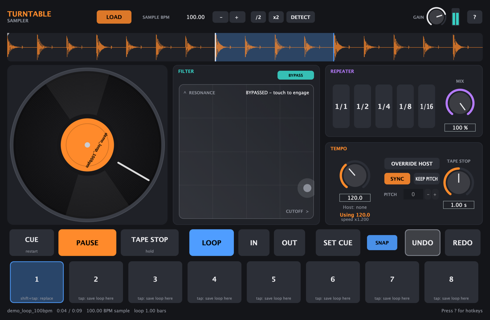

# Turntable Sampler

An open-source turntable-style sampler plugin for macOS (VST3 + AU + standalone app).
Load a sample, and it spins on a virtual platter: scratch it, tape-stop it, loop it,
beat-repeat it, filter it, and keep it in time with your project.



- Universal binary: Apple Silicon and Intel, macOS 11 or newer
- C++17, [JUCE 8](https://juce.com) (CMake), no proprietary dependencies
- License: GPLv3 (see [License](#license))

## Features

| Feature | How |
|---|---|
| Load a sample | Drop a WAV / AIFF / MP3 (also FLAC, M4A, CAF, OGG) on the platter, click **LOAD**, or press **O** |
| Sample BPM | Read from the file name (`loop_92bpm.wav`), otherwise auto-detected. Editable, with /2, x2 and DETECT |
| Platter playback | Varispeed: speed sets pitch, like a real record |
| Scratch | Hold **S** and move the mouse over the platter, or just drag on the platter. Release ramps back to speed in 80 ms |
| Tape stop | Hold **G**: slows to a stop over the Tape Stop time (0–4 s; 0 = instant); release spins back up over the same time |
| Play / pause | **Space** (with tape-stop ramp). **Shift+Space**: instant restart from the cue point |
| Loop | **L** loop on/off (1 bar from the playhead if no loop is set), **[** / **]** move loop in / out to the playhead |
| Loop pads 1–8 | **1–8** recall, **Shift+1–8** (or Shift+click) store the current loop |
| Repeater | Hold **Q W E R T** = 1/1, 1/2, 1/4, 1/8, 1/16 bar. Repeats the slice just played; the track keeps running underneath, so releasing lands back in time. **Mix** sets dry/wet |
| BPM sync | Plays at project BPM / sample BPM. Smoothly re-tempos with no jumps when the BPM changes |
| System BPM knob | Follows the host by default. **Up/Down** ±1, **Shift+Up/Down** ±10 (switches to "Override host"), or turn the knob |
| Keep pitch | **K**: tempo changes without pitch change (granular time-stretch). **-** / **=** shift pitch ±1 semitone |
| Filter | XY pad: X = cutoff, Y = resonance (low-pass state-variable filter). **F** bypass, **Left/Right** cutoff, **Alt+Up/Down** resonance |
| Extras | Waveform with playhead / loop / cue (click to jump), output gain and meter, undo/redo for loop edits (**Cmd+Z**, **Cmd+Shift+Z**), set cue (**C**) |
| Hotkeys | Every control has a key. Press **?** for the list. Keys are stored in an editable JSON file |

Everything you set (sample path, sample BPM, loop, cue, pads, all knobs) is saved with your Ableton set and restored when you reopen it.

## Hotkeys

The full list is in the **?** overlay and in [`config/hotkeys.example.json`](config/hotkeys.example.json).
Your own copy lives at:

```
~/Library/Application Support/Turntable Sampler/hotkeys.json
```

It is created on first launch. Edit it (the **?** overlay has an "Edit hotkeys.json" button), then press **Reload**.
Key names: `A`–`Z`, `0`–`9`, symbols, `Space`, `Up`, `Down`, `Left`, `Right`, `Return`, `Escape`, `Tab`;
modifiers `Shift+`, `Cmd+`, `Alt+`, `Ctrl+`; `"none"` unassigns. Clashes are reported in the overlay.

> **Keyboard focus:** the plugin only receives keys while its window is focused. Click inside it first.
> Some hosts keep certain keys for themselves (for example Space for the host transport). Rebind them in `hotkeys.json` if that happens.

## Build

Requirements: macOS with Xcode (command line tools) and CMake 3.22+ (`brew install cmake`).

```bash
scripts/build.sh
```

This produces universal `Turntable Sampler.vst3`, `Turntable Sampler.component` (AU) and `Turntable Sampler.app` in `dist/`, runs the engine tests, and installs the plugins into `~/Library/Audio/Plug-Ins`. Use `scripts/build.sh --no-install` to skip installing.
JUCE 8.0.15 is fetched automatically; put a checkout in `external/JUCE` to build offline.

Manual CMake:

```bash
cmake -S . -B build -DCMAKE_BUILD_TYPE=Release
cmake --build build --config Release
```

Validate (downloads pluginval on first run):

```bash
scripts/validate.sh
```

In Ableton Live: rescan plugins (Settings → Plug-Ins → Rescan), then drag **Turntable Sampler** onto a MIDI track. It is an instrument, so it needs no audio input.

## Validation results

Run on macOS 27.2.1 (Apple Silicon), Xcode 27.2, with plugins built by `scripts/build.sh`.

**Engine tests** (`build/TurntableTests_artefacts/Release/TurntableTests`):

```
playback at normal speed
tape stop and spin-up
play/pause ramp and hard restart at cue
scratch follows the hand, no clicks, ramps back
loop wraps without clicks
repeater 1/4 at 120 BPM
BPM sync and BPM change mid-playback
keep pitch
filter
sample rate changes and odd block sizes
running off the end
sample hand-over
BPM detection
hotkeys

allocations inside process(): 0
133 checks, 0 failed
```

**auval** (`auval -strict -v aumu Ttbl Tsmp`):

```
Render Test at 512 frames
Slicing Render Test at 64 frames
Render Test at 64 frames, sample rate: 22050 Hz
Render Test at 137 frames, sample rate: 96000 Hz
Render Test at 4096 frames, sample rate: 48000 Hz
...
--------------------------------------------------
AU VALIDATION SUCCEEDED.
--------------------------------------------------
```

**pluginval v1.0.4, strictness level 5**: all 19 test groups pass for both formats
(open cold/warm, plugin info, programs, editor, editor while processing, audio processing at
44.1/48/96 kHz with block sizes 64–1024 and 32-sample sub-blocks, plugin state, automation,
editor automation, automatable parameters, auval, vst3 validator, bus layouts).

```
VST3: Strictness level: 5 ... Completed tests in pluginval / Restoring default layout
SUCCESS
AU:   Strictness level: 5 ... Completed tests in pluginval / Restoring default layout
SUCCESS
```

The AU run prints one warning, `Current program is -1... Is this correct?`. That is informational: the plugin has no factory programs.

## How it works

- **Audio thread:** `src/engine/DeckEngine.cpp`. Positions are kept in the sample's own frames, so host sample-rate changes never move anything. Playback uses 4-point Hermite interpolation. Every jump (loop wrap, repeat wrap, cue restart, pad recall, click-to-seek) crossfades over 5 ms, and a DC blocker keeps a stopped record silent. No allocation, no locks; the tests count allocations and require zero.
- **Scratch:** the mouse position becomes a target position. A critically damped follower turns it into a smooth velocity, so 60 Hz mouse updates do not cause zipper noise.
- **Tape stop:** the motor speed ramps linearly; position and pitch follow it.
- **Repeater:** a second read head loops the slice. The main head keeps running, so releasing simply fades the repeat out.
- **Keep pitch:** two overlapping 40 ms Hann-windowed grains. Scratching and tape stops always switch back to varispeed, because that is how a record behaves.
- **UI → audio:** a lock-free command FIFO (`src/engine/Commands.h`) plus atomics. New samples are handed over by pointer, and the old one is freed later on the message thread (`src/engine/SampleSlot.cpp`).

## Known limitations

- Keep pitch uses a simple granular stretch: fine for loops, audibly grainy on sustained material.
- The repeater and loop lengths assume 4/4.
- MIDI notes do not trigger anything yet (planned: pads and transport on MIDI notes, useful when the host keeps keyboard focus).
- Samples longer than 20 minutes are cut at 20 minutes.

## License

Turntable Sampler is free software under the GNU General Public License v3.0 (see [`LICENSE`](LICENSE)).
It uses JUCE 8 under its AGPLv3 open-source licence. GPLv3 §13 allows combining with AGPLv3 code, and the JUCE portions stay under the AGPLv3.
VST is a trademark of Steinberg Media Technologies GmbH. Audio Units is a trademark of Apple Inc.
